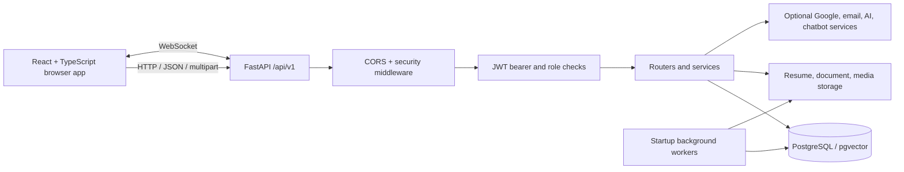
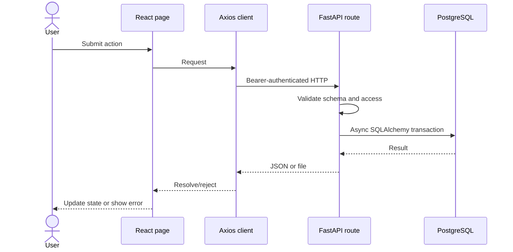

# System Architecture

## Overview

The system is a React single-page client backed by a versioned FastAPI API. The client sends JSON, multipart, and file requests over HTTP and uses WebSockets for live chat and interview signalling. FastAPI validates requests with Pydantic, resolves auth/role dependencies, runs asynchronous SQLAlchemy operations against PostgreSQL, and may call external providers or file storage.

## Backend request lifecycle

1. `backend/app/main.py` creates the FastAPI application and lifespan.
2. CORS/security middleware processes requests; a global exception handler handles uncaught exceptions.
3. `backend/app/api/v1/router.py` dispatches under `/api/v1`.
4. Dependencies provide database sessions and authenticated users/roles.
5. Pydantic validates request data.
6. Router/service logic authorizes access and performs SQLAlchemy, file, or provider operations.
7. The route returns a response model, JSON/dictionary, or file/stream response.

The application lifespan runs Alembic to head, seeds Interview Studio catalogs, optionally prepares chatbot knowledge, and starts interview reminder/expiry and recording-retention workers. Startup also conditionally initializes Mailpit.

## Frontend architecture

- `App.tsx` sets up providers, routing, session behavior, and application shell.
- `lib/routes.ts` declares route access and page components; `ProtectedRoute` restricts access by role.
- `pages/` contains route-level screens; `components/` contains reusable interface elements.
- `api/client.ts` centralizes Axios auth, refresh/retry, and error behavior.
- `services/` contains feature API wrappers.
- Zustand stores auth, theme, and view mode; most page data uses local React state. TanStack Query is used selectively.

## Persistence, authentication, and real-time communication

The database engine/session are in `backend/app/core/database.py`. Alembic migrations under `backend/alembic/versions/` evolve PostgreSQL. JWT bearer access tokens and DB-backed refresh records support session renewal; role dependencies enforce student/company/admin access. WebSocket handlers authenticate the caller and check participant/ownership rules.

Resumes and company documents use upload/download routes. Interview recordings use consent, chunk upload, finalization, retrieval, deletion, and retention. Chat messages use REST persistence plus WebSocket events.

## Integrations and caveats

The code includes optional Google Identity Services, SMTP/Mailpit, AI interview and chatbot providers, embedding/vector retrieval, Redis, GitHub lookup, browser notifications, speech recognition, and media APIs. Each has configuration/runtime requirements. Some backend service logic is colocated in route modules; the architecture does not enforce a single service/repository pattern. Several migration-created tables lack ORM mappings. See the [API](./06_API_Documentation.md) and [Database](./07_Database_Documentation.md) references for further detail.
