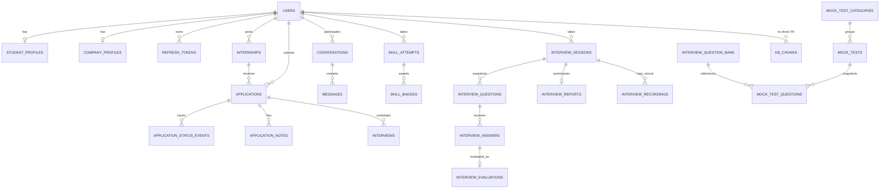

# Database Documentation

## Database and migration process

The application uses PostgreSQL with SQLAlchemy's asynchronous ORM (`asyncpg`). Alembic migrations live in `backend/alembic/versions/`; the inspected current head is `0052_interview_two_categories`, whose parent is `0051_skill_topic_repair`. Backend startup applies migrations to `head`, so production should use a migration-aware deployment process and backup before applying schema changes.

Types below are SQLAlchemy/Python-oriented summaries (`Integer`, `String(n)`, `Text`, `Boolean`, `DateTime(timezone=True)`, `JSON`, `Float`, `Date`, and PostgreSQL `Vector(384)`). PK/FK/unique/index/check constraints are listed after each domain. Nullability/default details are included where important; consult model and migration source for database-specific DDL.

## Entity relationship overview

The last relationship is intentionally not an FK: `kb_chunks` stores indexed knowledge content, not per-user content. Self-references and operational tables are omitted from the diagram for readability.

## Current ORM-mapped tables

### Identity, profiles, and email

| Table | Columns (type; PK marked `PK`) |
|---|---|
| `users` | `id: Integer PK`; `email: String(255)`; `password_hash: String(255)`; `role: Enum(UserRole)`; `is_active: Boolean`; `is_verified: Boolean`; `created_at: DateTime`; `first_login_at: DateTime?`; `email_verified_at: DateTime?`; `student_verified: Boolean`; `institution_verified: Boolean`; `organization_verified: Boolean`; `admin_approved: Boolean`; `suspended_at: DateTime?`; `verification_token: String(255)?`; `verification_token_expires_at: DateTime?`; `reset_token: String(255)?`; `reset_token_expires_at: DateTime?`; `mfa_enabled: Boolean`; `mfa_type: String(20)`; `mfa_secret: String(255)?`; `mfa_otp: String(64)?`; `mfa_otp_expires_at: DateTime?` |
| `student_profiles` | `id: Integer PK`; `user_id: Integer FK users.id`; `full_name: String(255)`; `university: String(255)`; `major: String(255)`; `graduation_year: Integer`; `bio: Text?`; `skills: Text`; `institution_email: String(255)?`; `avatar_url: String(500)?`; `github_username: String(39)?`; `leetcode_username: String(50)?`; `show_verified_badges: Boolean` |
| `company_profiles` | `id: Integer PK`; `user_id: Integer FK users.id`; `company_name: String(255)`; `industry: String(255)`; `website: String(500)?`; `description: Text?`; `verification_status: String(20)`; `verification_note: Text?`; `avatar_url: String(500)?`; `company_size: String(40)?`; `location: String(255)?`; `recruiter_contact_name: String(255)?`; `recruiter_contact_phone: String(40)?`; `recruiter_contact_email: String(255)?` |
| `company_documents` | `id: Integer PK`; `company_id: Integer FK users.id`; `document_type: String(40)`; `original_filename: String(255)`; `stored_filename: String(255)`; `content_type: String(100)`; `file_size: Integer`; `created_at: DateTime` |
| `refresh_tokens` | `id: Integer PK`; `jti: String(255)`; `user_id: Integer FK users.id`; `expires_at: DateTime`; `revoked_at: DateTime?`; `rotated_at: DateTime?`; `reuse_until: DateTime?`; `replacement_tokens: Text?` |
| `email_verification_tokens` | `id: Integer PK`; `user_id: Integer FK users.id`; `token_digest: String(64)`; `expires_at: DateTime`; `used_at: DateTime?`; `created_at: DateTime` |
| `email_messages` | `id: Integer PK`; `user_id: Integer FK users.id`; `recipient_email: String(255)`; `sender_email: String(255)`; `subject: String(255)`; `message_type: String(50)`; `body: Text`; `html: Text?`; `application_id: Integer? FK applications.id`; `message_id: String(998)?`; `delivered_via_smtp: Boolean`; `created_at: DateTime` |

Constraints/indexes: `users.email` is unique and indexed; verification/reset token values are unique where present. Student and company profile `user_id` values are unique, enforcing one-to-one profiles. Refresh-token JTI is unique. Email, user, expiry, and lookup columns have indexes as declared in the models.

### Opportunities, applications, and communication

| Table | Columns |
|---|---|
| `internships` | `id: Integer PK`; `company_id: Integer FK users.id`; `title: String(255)`; `description: Text`; `location: String(255)`; `industry: String(255)`; `duration_months: Integer`; `stipend: Integer?`; `work_mode: String(30)`; `skills: Text`; `deadline: Date`; `status: String(30)`; `created_at: DateTime`; `closed_at: DateTime?` |
| `applications` | `id: Integer PK`; `internship_id: Integer FK internships.id`; `student_id: Integer FK users.id`; `status: String(30)`; `cover_note: Text?`; `offer_signed_name: String(200)?`; `offer_signature_mode: String(10)?`; `offer_accepted_at: DateTime?`; `created_at: DateTime`; `updated_at: DateTime` |
| `application_status_events` | `id: Integer PK`; `application_id: Integer FK applications.id`; `from_status: String(30)?`; `to_status: String(30)?`; `changed_at: DateTime`; `changed_by_user_id: Integer? FK users.id`; `note: Text?` |
| `application_events` | `id: Integer PK`; `application_id: Integer FK applications.id`; `event_type: String(30)`; `actor_id: Integer? FK users.id`; `created_at: DateTime` |
| `resumes` | `id: Integer PK`; `student_id: Integer FK users.id`; `original_filename: String(255)`; `stored_filename: String(255)`; `content_type: String(100)`; `file_size: Integer`; `uploaded_at: DateTime?` |
| `saved_internships` | `id: Integer PK`; `student_id: Integer FK users.id`; `internship_id: Integer FK internships.id`; `created_at: DateTime` |
| `company_reviews` | `id: Integer PK`; `company_id: Integer FK users.id`; `student_id: Integer FK users.id`; `internship_id: Integer FK internships.id`; `rating: Integer`; `review_text: Text`; `created_at: DateTime` |
| `conversations` | `id: Integer PK`; `student_id: Integer FK users.id`; `company_id: Integer FK users.id`; `created_at: DateTime` |
| `messages` | `id: Integer PK`; `conversation_id: Integer FK conversations.id`; `sender_id: Integer FK users.id`; `body: Text`; `created_at: DateTime`; `read_at: DateTime?` |
| `interviews` | `id: Integer PK`; `application_id: Integer FK applications.id`; `scheduled_by: Integer FK users.id`; `scheduled_at: DateTime`; `interview_type: String(30)`; `meeting_link: String(500)?`; `notes: Text?`; `status: String(20)`; `result: String(20)?`; `rating: Integer?`; `feedback: Text?`; `feedback_at: DateTime?`; `change_reason: Text?`; `reminder_24h_sent_at: DateTime?`; `reminder_1h_sent_at: DateTime?`; `cancel_reason: String(100)?`; `cancelled_at: DateTime?` |
| `application_notes` | `id: Integer PK`; `application_id: Integer FK applications.id`; `author_user_id: Integer FK users.id`; `body: Text`; `created_at: DateTime` |
| `notifications` | `id: Integer PK`; `user_id: Integer FK users.id`; `application_id: Integer? FK applications.id`; `notification_type: String(50)`; `title: String(255)`; `body: Text`; `created_at: DateTime`; `read_at: DateTime?` |
| `reports` | `id: Integer PK`; `reporter_id: Integer FK users.id`; `reported_user_id: Integer? FK users.id`; `internship_id: Integer? FK internships.id`; `reason: Text`; `status: String(20)`; `resolution_notes: Text?`; `created_at: DateTime`; `updated_at: DateTime` |

Constraints/indexes: applications are unique by `(student_id, internship_id)`; resumes are unique by `student_id` and stored filename; saved internships are unique by `(student_id, internship_id)`; company reviews are unique by `(student_id, internship_id)`. Application status/event records cascade on application deletion where declared; optional actor/user links generally use `SET NULL`.

### Audit, skill assessments, and chatbot

| Table | Columns |
|---|---|
| `audit_logs` | `id: Integer PK`; `actor_id: Integer? FK users.id`; `actor_email: String(255)?`; `action: String(60)`; `target_type: String(30)?`; `target_id: String(100)?` (custom numeric-string adapter); `metadata: JSON?`; `ip_address: String(45)?`; `created_at: DateTime` |
| `skill_questions` | `id: Integer PK`; `topic: String(100)`; `prompt: Text`; `options: JSON`; `correct_index: Integer`; `correct_answers: JSON?`; `explanation: Text`; `difficulty: String(30)`; `subtopic: String(100)`; `question_type: String(20)`; `source: String(500)`; `active: Boolean`; `key_reviewed_at: DateTime?`; `key_reviewed_by: Integer? FK users.id`; `created_at: DateTime` |
| `skill_topics` | `slug: String(100) PK`; `name: String(150)`; `description: Text`; `icon: String(80)`; `badge_title: String(255)`; `active: Boolean`; `archived_at: DateTime?`; `archived_by: Integer? FK users.id`; `updated_at: DateTime` |
| `skill_attempts` | `id: Integer PK`; `student_id: Integer FK users.id`; `topic: String(100)`; `status: String(20)`; `question_ids: JSON`; `question_snapshots: JSON`; `option_orders: JSON`; `answers: JSON?`; `score: Integer?`; `raw_score: Float?`; `weighted_percentage: Float?`; `level: String(20)?`; `time_taken_seconds: Integer?`; `attempt_number: Integer`; `question_time_seconds: JSON?`; `subtopic_scores: JSON?`; `difficulty_scores: JSON?`; `percentile: Float?`; `passed: Boolean?`; `started_at: DateTime`; `expires_at: DateTime`; `submitted_at: DateTime?` |
| `skill_badges` | `id: Integer PK`; `student_id: Integer FK users.id`; `topic: String(100)`; `title: String(255)`; `level: String(20)`; `score: Integer`; `attempt_id: Integer FK skill_attempts.id`; `earned_at: DateTime`; `expires_at: DateTime` |
| `skill_learning_resources` | `id: Integer PK`; `topic: String(100)`; `subtopic: String(100)`; `title: String(255)`; `url: String(1000)`; `created_by_user_id: Integer? FK users.id`; `active: Boolean`; `created_at: DateTime` |
| `chatbot_low_confidence_logs` | `id: Integer PK`; `role: String(20)`; `question: Text`; `created_at: DateTime` |
| `chatbot_feedback` | `id: Integer PK`; `user_id: Integer FK users.id`; `role: String(20)`; `rating: String(10)`; `source_type: String(30)`; `turn_id: String(80)`; `created_at: DateTime` |

Constraints/indexes: skill questions have unique `(topic, prompt)`; attempts have a partial unique index allowing one in-progress attempt per `(student_id, topic)`; resources are unique by `(topic, subtopic, url)`. Skill question correctness and chatbot prompt/feedback content are sensitive application data; access must follow the relevant student/admin endpoints.

### Interview Studio

| Table | Columns |
|---|---|
| `interview_sessions` | `id: Integer PK`; `student_id: Integer FK users.id`; `mock_test_id: Integer? FK mock_tests.id`; `mock_test_version: Integer?`; `session_type: String(20)`; `interview_mode: String(20)`; `current_question_position: Integer?`; `category: String(30)`; `difficulty: String(20)`; `legacy_category: String(50)?`; `legacy_difficulty: String(50)?`; `question_count: Integer`; `time_limit_seconds: Integer`; `status: String(30)`; `consent_acknowledged: Boolean`; `consent_acknowledged_at: DateTime?`; `proctoring_consent_acknowledged: Boolean`; `proctoring_consent_acknowledged_at: DateTime?`; `proctoring_max_violations: Integer`; `retake_of_session_id: Integer? FK interview_sessions.id`; `created_at`, `started_at`, `expires_at`, `completed_at: DateTime?` |
| `interview_question_bank` | `id: Integer PK`; `seed_key: String(100)`; `category: String(30)`; `difficulty: String(20)`; `legacy_category: String(50)?`; `legacy_difficulty: String(50)?`; `prompt: Text`; `hint: Text`; `rubric: Text`; `active: Boolean`; `source_metadata: JSON`; `created_at: DateTime` |
| `mock_test_categories` | `id: Integer PK`; `slug: String(50)`; `title: String(100)`; `active: Boolean`; `legacy_category: String(50)?`; `legacy_difficulty: String(50)?` |
| `mock_tests` | `id: Integer PK`; `slug: String(100)`; `title: String(160)`; `description: Text`; `category_id: Integer FK mock_test_categories.id`; `difficulty: String(20)`; `legacy_category: String(50)?`; `legacy_difficulty: String(50)?`; `format: String(30)`; `default_mode: String(20)`; `question_count: Integer`; `time_limit_seconds: Integer`; `question_filter: JSON?`; `skill_tags: JSON`; `company_style: Boolean`; `active: Boolean`; `version: Integer`; `source_metadata: JSON`; `created_at: DateTime` |
| `mock_test_questions` | `id: Integer PK`; `mock_test_id: Integer FK mock_tests.id`; `version: Integer`; `question_bank_id: Integer FK interview_question_bank.id`; `position: Integer`; `skill_tags: JSON` |
| `interview_studio_difficulties` | `code: String(20) PK`; `label: String(40)`; `active: Boolean`; `legacy_category: String(50)?`; `legacy_difficulty: String(50)?` |
| `interview_studio_settings` | `key: String(60) PK`; `value: JSON`; `updated_by: Integer? FK users.id`; `updated_at: DateTime`; `legacy_category: String(50)?`; `legacy_difficulty: String(50)?` |
| `interview_studio_admin_audit` | `id: Integer PK`; `actor_id: Integer? FK users.id`; `action: String(60)`; `entity_type: String(40)`; `entity_id: String(100)?`; `summary: JSON`; `created_at: DateTime` |
| `interview_studio_usage_events` | `id: Integer PK`; `event_type: String(10)`; `status: String(10)`; `duration_ms: Integer`; `retry_count: Integer`; `prompt_tokens: Integer`; `completion_tokens: Integer`; `audio_seconds: Float`; `error_code: String(60)?`; `created_at: DateTime` |
| `interview_questions` | `id: Integer PK`; `session_id: Integer FK interview_sessions.id`; `question_bank_id: Integer? FK interview_question_bank.id`; `follow_up_to_question_id: Integer? FK interview_questions.id`; `follow_up_to_answer_id: Integer?` (not an FK); `position: Integer`; `prompt: Text`; `hint: Text?`; `rubric: Text`; `skill_tags: JSON`; `source_metadata: JSON`; `is_follow_up: Boolean`; `created_at: DateTime` |
| `interview_answers` | `id: Integer PK`; `question_id: Integer FK interview_questions.id`; `answer_text: Text`; `assessment_slot: Integer?`; `duration_seconds: Float?`; `word_count: Integer?`; `speaking_pace_wpm: Float?`; `filler_word_count: Integer?`; `submitted_at: DateTime` |
| `interview_evaluations` | `id: Integer PK`; `answer_id: Integer FK interview_answers.id`; `status: String(20)`; `relevance`, `technical_correctness`, `completeness`, `communication`, `structure: Integer?`; `feedback: Text?`; `strengths: JSON?`; `improvements: JSON?`; `failure_code: String(50)?`; `model_name: String(150)?`; `evaluated_at: DateTime?`; `created_at: DateTime` |
| `interview_reports` | `id: Integer PK`; `session_id: Integer FK interview_sessions.id`; `status: String(20)`; `overall_score: Float?`; `rubric_scores: JSON?`; `skill_breakdown: JSON?`; `answer_count: Integer`; `summary: Text?`; `failure_code: String(50)?`; `created_at: DateTime`; `completed_at: DateTime?` |
| `interview_consents` | `id: Integer PK`; `session_id: Integer FK interview_sessions.id`; `student_id: Integer FK users.id`; `consent_type: String(30)`; `version: String(50)`; `acknowledged_at: DateTime` |
| `interview_proctoring_events` | `id: Integer PK`; `session_id: Integer FK interview_sessions.id`; `user_id: Integer FK users.id`; `event_type: String(30)`; `occurred_at: DateTime`; `metadata: JSON`; `created_at: DateTime` |
| `interview_recordings` | `id: Integer PK`; `session_id: Integer FK interview_sessions.id`; `student_id: Integer FK users.id`; `storage_key: String(36)`; `status: String(20)`; `mime_type: String(100)`; `chunk_count: Integer`; `total_bytes: Integer`; `duration_seconds: Float?`; `retention_expires_at: DateTime`; `created_at: DateTime`; `completed_at: DateTime?`; `deleted_at: DateTime?` |

Important constraints: interview categories are `HR|TECHNICAL`, difficulty is `INTERMEDIATE`, session type and status are constrained, and question counts/time are checked. Question bank seed keys and mock-test slugs are unique. Test question positions and session question positions are unique within their snapshots. Evaluation/report rows are unique per answer/session. Recording status and counters are constrained. Check the model and migration for complete enum/check definitions.

### Knowledge base

| Table | Columns |
|---|---|
| `kb_chunks` | `id: BigInteger PK`; `doc_id: String(255)`; `source_path: String(1000)`; `title: String(500)`; `section: String(500)`; `content: Text`; `audience: String(20)`; `route_hint: String(500)`; `content_hash: String(64)`; `embedding: Vector(384)`; `word_count: Integer`; `created_at: DateTime`; `updated_at: DateTime` |

Unique `(source_path, content_hash)`. Indexes include audience, an HNSW vector index using cosine operations, and a PostgreSQL GIN full-text index over title/section/content. `KBChunk` is mapped in `backend/app/models/kb_chunk.py` but is not exported from the main model package.

## Migration-created tables without mapped ORM classes

The following tables are present in migration history but have no current SQLAlchemy class in the inspected model package.

| Table | Columns and relationships |
|---|---|
| `learning_categories` | `id PK`, `slug` unique, `title`, `description`, `active`. |
| `learning_resources` | `id PK`, `slug` unique, `category_id FK learning_categories` (restrict), `title`, `description`, `url`, `resource_type`, `level`, JSON `role_tags`, JSON `topic_tags`, `active`, `verified_at?`, `created_by? FK users` (set null), `updated_at`. |
| `learning_paths` | `id PK`, `slug` unique, `category_id FK learning_categories` (restrict), `title`, `description`, JSON `role_tags`, JSON `topic_tags`, `active`, `created_at`. |
| `learning_path_resources` | `id PK`, `learning_path_id FK learning_paths` (cascade), `resource_id FK learning_resources` (restrict), `position`; unique by path/position and path/resource; positive position. |
| `student_resource_progress` | `id PK`, `student_id FK users` (cascade), `resource_id FK learning_resources` (cascade), `status`, `viewed_at`, `completed_at?`; unique by student/resource. |
| `student_bookmarks` | `id PK`, `student_id FK users` (cascade), `resource_id FK learning_resources` (cascade), `created_at`; unique by student/resource. |
| `student_learning_preferences` | `student_id PK/FK users` (cascade), `target_role?`, `updated_at`. |
| `skills` | `id PK`, `canonical_name` unique, JSON `aliases`. |
| `role_skill_requirements` | `id PK`, `role_slug`, `role_label`, `skill_id FK skills` (cascade), `requirement_type`; unique by role/skill; required/preferred check. |
| `skill_gap_reports` | `id PK`, `student_id FK users` (cascade), `target_type`, `target_id?`, `target_label`, `estimated_match_score?`, JSON `snapshot`, `created_at`; target type and score checked. |

These are defined in migrations `0047_student_learning_library.py` and `0048_skill_gap_analysis.py`. They should not be assumed to have active API/ORM workflows just because the tables exist.

## Historical table and migration notes

- `endorsements` was created by migration `0015_endorsements.py` and later dropped by `0020_drop_endorsements.py`; it is not a current table.
- Interview migration `0052_interview_two_categories` added legacy category/difficulty preservation and normalized current interview data.
- Several workflows snapshot question data into attempts/sessions so later bank edits do not rewrite historical attempts.
- Migration history is the authoritative source for actual database DDL; the model layer does not represent every historical table.
